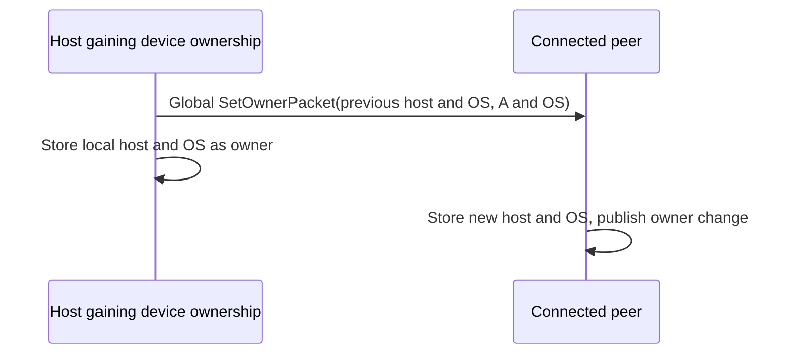
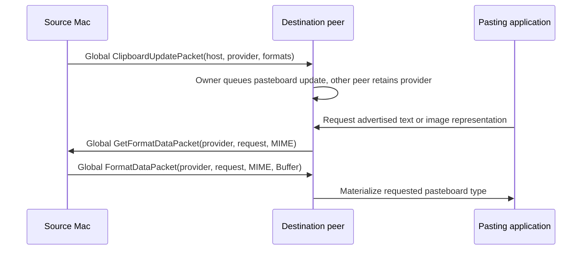
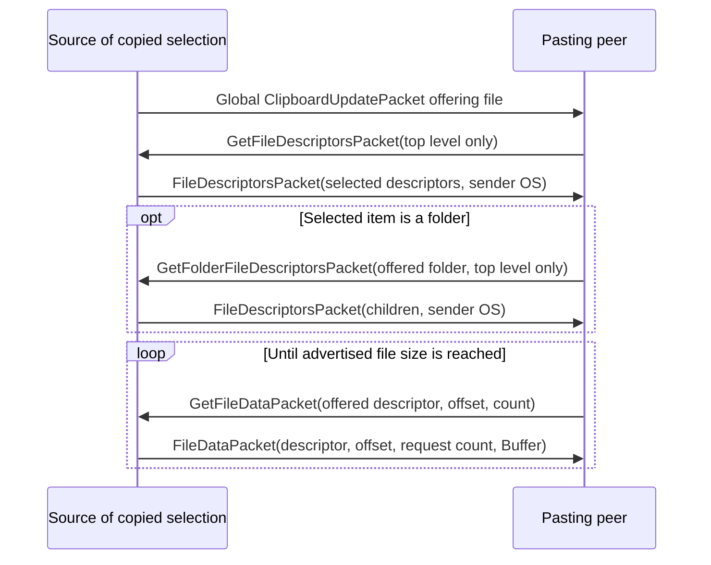
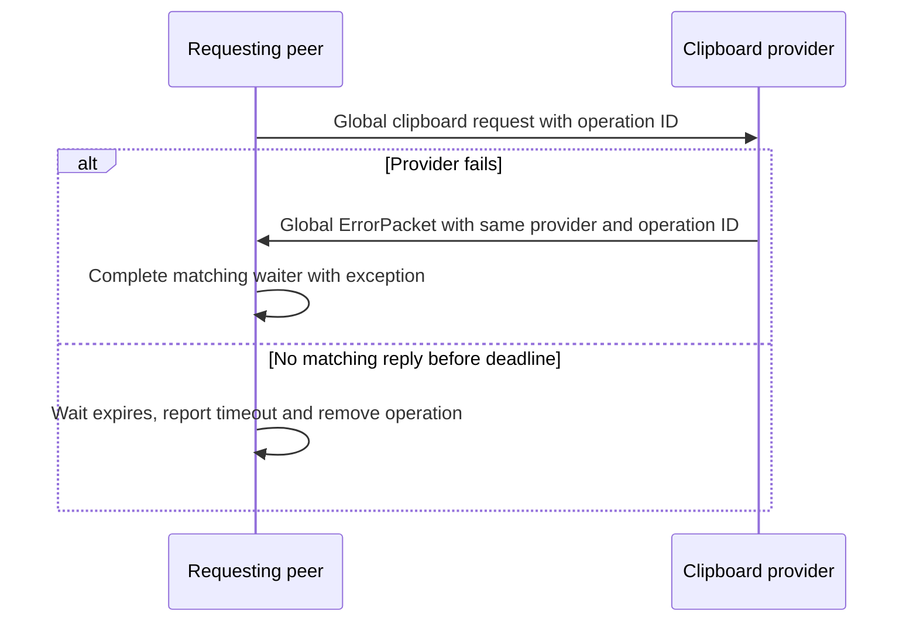

# Options+ 2.9.1013853 Flow protocol

The installed macOS agent has CFBundleVersion `2.9.1013853` and arm64 slice UUID
`720ECD68-7951-36C2-AA37-19CEE0DA0693`. Addresses below are unslid virtual
addresses in that slice. The format descriptions below come from static
disassembly. The codec tests use constructed vectors and synthetic keys.

## Live verification (2026-11-24)

Earlier operator sessions used native macOS arm64 Options+ 2.9.1013853 on
two Macs with Omarchy running Hyprland 0.56.2. The first Mac and Omarchy
completed bidirectional edge crossings with an MX Master 3S B. With Link
Keyboard enabled, the Logi K865 followed the mouse. Native Settings sync
carried the peer layout, keyboard link and hold-Ctrl rule. Stage 2.5 checked
Hyprland's modifier query and the held/released edge-gating branches.

During Stage 3A the existing daemon's status showed both Mac tunnels connected,
a horizontal layout, Link Keyboard and hold-Ctrl enabled. The second Mac's layout row
was disabled at that readback. The physical crossing record identifies the first Mac;
a crossing from the second Mac and a new physical crossing on the staged Stage 3A
source have no independent receipt.

The Stage 3A read-only device check on Omarchy found relative bits `1943` and
key words `ffff0000 0 0 0 0` on the Bolt if01 mouse. The keyboard interface
reported no relative axes. Verification opened the mouse and closed it without
reading events.

## Network-endian serializer

| Value | Wire representation | Native evidence |
| --- | --- | --- |
| Fixed-width integer | Most significant byte first | Network-endian buffer setup at `0x101b7659c`, integer writer e.g. `0x101f84b58` |
| Boolean | One byte. Writers emit 0 or 1. The reader returns true only for 1. | `0x101f82730`, `0x101f8282c` |
| SizeT below 2⁵⁶ | Choose the least width w in 1…8 that holds the value in 7w bits. Emit `((2 * value + 1) << (w - 1))` as w little-endian bytes. The position of the first set bit in the first byte determines w. | `0x101f8765c`, `0x101f87780` |
| SizeT from 2⁵⁶ to 2⁶⁴−1 | Zero marker followed by a big-endian u64 | Same operators, extended-width branches |
| C++ string | SizeT byte count, followed by exactly that many raw bytes | `0x101f82f6c`, `0x101f830d4` |
| Buffer | One endianness byte, then capacity, read offset and write offset as three SizeTs, then the allocator's serialized name as a string, then exactly capacity bytes of storage | `0x101f38424`, `0x101f385a8` |
| Serializable | Four bytes `FARS`, type name as a string, u16 version, SizeT payload length, payload | `0x101136720` |

Buffer metadata describes the backing storage. Bytes beyond the write offset
are included on the wire. The allocator name comes from the object's
`Allocator::GetSerializedName()`. The Python codec carries those bytes through
as data. It also checks that the read and write offsets fit the supplied storage.

## Frame and plaintext

The outer header is a 32-byte key ID followed by a big-endian u32 block size.
The block starts with u16 IV length, u32 ciphertext length and u16 tag length,
followed by IV, ciphertext and tag in that order. The block size includes the
eight length bytes. The AES-256-GCM codec uses a 12-byte IV and a 16-byte tag.
It checks the expected key ID separately. Both packet call sites pass an empty
AAD pointer and a zero AAD length.

The frame writer is at `0x101bd42a0`, its header writer at `0x101bd44a4`,
and the cipher writer and reader at `0x101bd3b14` and `0x101bd473c`.
`Encryptor::Init` at `0x101bf2af8` obtains the IV length from the configured
EVP context. `GetTag` at `0x101bf30e8` requests 16 bytes.

The plaintext writer at `0x101b76500` draws an unsigned random value,
takes it modulo 101, and repeats on zero. It writes a one-byte padding length,
one flag byte, then 1–100 random bytes. Bit 0 adds a 16-byte raw session GUID
and a big-endian u64 sequence. Bit 1 compresses the following FARS object using
zlib level 9. The session header precedes the compressed stream. The reader
at `0x101b7699c` skips padding, verifies an included session header against its
session and inflates the object when bit 1 is set. The offline wrapper exposes
session fields without maintaining peer state. Its decoder rejects unknown
flag bits and limits inflated data to 16 MiB by default.

## Packet bodies

The following layouts describe each class's FARS payload. Each table entry
lists its native read and write addresses in that order. Integer fields use
network byte order, and “string” means the byte string specified above.

| Type | Version | Fields in order | Read / write |
| --- | --- | --- | --- |
| InitiateDiscoveryPacket | 1 | device ID, serial number, channel (three u32), force (bool) | `0x10157cd64` / `0x10157cda0` |
| BeaconPacket | 2 | three identity/channel u32s, host ID (string), force (bool), port (u16) | `0x10154e2d0` / `0x10154e31c` |
| PingPacket | 2 | same fields as BeaconPacket | `0x1015b41c0` / `0x1015b420c` |
| HeartbeatPacket | 1 | lastReceivedPacketTime, currentTime (two signed i64) | `0x101579fbc` / `0x101579fe8` |
| GlobalDataPacket | 1 | host ID (string), chunk number and chunk count (SizeT), Buffer | `0x101574d44` / `0x101574d80` |
| DeviceDataPacket | 1 | three identity/channel u32s, two chunk SizeTs, Buffer | `0x10156921c` / `0x101569268` |
| SettingsPacket | 1 | three identity/channel u32s, then Settings inline | `0x10112128c` / `0x1011213a4` |

`Settings` writes counter (u32), layout (string), then six booleans in order:
on, ctrlKey, copyPaste, dragDrop, hotCorners and keyboardLink. Next come
keyboard ID and keyboard serial number (u32 each), then three inline Peer
records. Each Peer contains channel (u32), keyboard channel (u32), host ID
(string) and enabled (bool). The third enabled byte ends the Settings payload.
The enclosing DeviceDataPacket ends with its serialized Buffer, which has its
own length and offsets. Chunk contents are opaque in this library.

The Settings operators are at `0x1011212c8` and `0x1011213e4`. Field names
come from `Settings::Parse` and `Settings::Peer::Parse` at `0x10111f2dc` and
`0x10111d0a4`. `GetDefaultSettings` at `0x10111d8e4` accepts channel 0, 1
or 2 and initializes the three mouse channel fields with those values. Default
keyboard channels contain `0xffffffff`. The codec preserves the wire values.

The native Version methods for ClientHello, ServerHello, PromoteConnection,
ClientDeviceConnect, ServerDeviceConnect, InitiateFlow, SetCurrentHost and
SetOwner all return 1. Their exact binary schemas (all network-endian, using
open-source `thekogans/util`, `thekogans/crypto`, and `thekogans/packet`
serialization) are listed below.

| Type | Version | Fields in order |
| --- | --- | --- |
| ClientHelloPacket | 1 | host ID (string), cipherSuite (string, `"ECDHE_ECDSA_AES-256-GCM_SHA2-512"`), params (`Serializable` = `DHEKeyExchange::DHEParams`) |
| ServerHelloPacket | 1 | host ID (string), session (`Session`: 16-byte GUID, u64be inboundSeq, u64be outboundSeq), cipherSuite (string), params (`Serializable` = `DHEKeyExchange::DHEParams`) |
| PromoteConnectionPacket | 1 | host ID (string) |
| ClientDeviceConnectPacket | 1 | device ID, serial number, channel (three u32be), host ID (string) |
| ServerDeviceConnectPacket | 1 | device ID, serial number, channel (three u32be), host ID (string) |
| InitiateFlowPacket | 1 | edge (u32be: `0=Left, 1=Right, 2=Top, 3=Bottom`), normalized position (f32be) |
| SetCurrentHostPacket | 1 | channel (u32be) |
| SetOwnerPacket | 1 | previous owner host ID (string), previous flag (u8), new owner host ID (string), new flag (u8) |

## Key derivation and DHE handshake (`thekogans/crypto`)

All cryptographic primitives follow the open-source `thekogans/crypto` library:

### `SymmetricKey::FromSecretAndSalt`

PBKDF1-style iterative digest loop (`md` = `SHA2-256` or `SHA2-512`, `count >= 1`):

```text
out = b""
prev = b""
while len(out) < key_length:
    h = digest(prev + secret + (salt or b""))
    for _ in range(1, count):
        h = digest(h)
    prev = h
    out += h[: key_length - len(out)]
```

### Per-device key derivation (`Device::CreateCipher`)

- `key_id = SHA-256(f"Master device key for: {device_id}:{serial_number}.".encode("ascii"))` (32 bytes).
- Secret buffer (network endian):
  - `u32be(device_id) + u32be(serial_number)`
  - `Buffer(endian=1, read_offset=0, write_offset=len(rnd), allocator=b"DefaultAllocator", storage=rnd)` where `rnd` is the 64-byte lowercase ASCII hex representation of the mouse's 32-byte HID++ `0x0021` hardware identifier. (Although `Device::Device` constructs a `SecureBuffer` using `SecureAllocator`, `SecureAllocator::StaticInit()` is not called in the agent binary, so `Allocator::GetSerializedName()` at `0x101f353cc` falls back to `"DefaultAllocator"`, verified live against Options+ `2.9.1013853`.)
  - `Buffer(endian=1, read_offset=0, write_offset=len(pw), allocator=b"DefaultAllocator", storage=pw)` where `pw` is the optional UTF-8 password bytes (empty by default).
- `key = FromSecretAndSalt(secret_buffer, salt=None, key_length=32, md="SHA2-256", count=1)` (AES-256-GCM).

### `DHEKeyExchange::DHEParams`, `X25519Params`, and `X25519AsymmetricKey`

- `X25519Params` (FARS type `b"X25519Params"`, version `1`):
  - `id` (32 raw bytes), `name` (string), `description` (string).
- `X25519AsymmetricKey` (FARS type `b"X25519AsymmetricKey"`, version `1`):
  - `id` (32 raw bytes), `name` (string), `description` (string), `is_private` (bool u8: `0` for public key), `key` (32 raw bytes directly — **no** `SizeT` length prefix).
  - Total FARS-encoded size with empty `name` and `description`: 94 bytes.
- `DHEKeyExchange::DHEParams` (FARS type `b"DHEKeyExchange::DHEParams"`, version `1`):
  - Base `KeyExchange::Params`: `id` (32 raw bytes), `signature` (`SizeT` + bytes; empty when unsigned), `signature_key_id` (32 raw bytes; ignored when `signature` is empty; Options+ sends a non-zero default-constructed `ID`), `signature_md_name` (string; empty when unsigned).
  - `params` (`Serializable` = `X25519Params`), `salt` (`SizeT` + bytes; empty by default), `key_length` (`SizeT`, `32`), `message_digest_name` (string, `b"SHA2-512"`), `count` (`SizeT`, `1`), `key_id` (32 raw bytes, negotiated session key ID), `key_name` (string), `key_description` (string), `public_key` (`Serializable` = `X25519AsymmetricKey`).
- Session key derivation (`DHEKeyExchange::DeriveSharedSymmetricKey`):
  - `shared_secret = X25519(local_private_key, remote_public_key)` (32 bytes).
  - `kdf_salt = SizeT(len(salt)) + salt + encode(initiator_public_key) + encode(responder_public_key)` (189 bytes when `salt` is empty).
  - `session_key = FromSecretAndSalt(shared_secret, kdf_salt, key_length=32, md="SHA2-512", count=1)`.

### Tunnel framing, session sequence numbers, and nested packets

- Discovery (`BroadcastDiscovery` on UDP 59870 / `NodeStoreDiscovery` on UDP 59871):
  - `BeaconPacket.port` carries the sender's UDP ping port (`59870`), whereas `PingPacket.port` carries the sender's TCP connect port (`59869`).
  - When pairing an unassigned channel (saved peer `hostId == ""`), `force` must be `true`; otherwise `HandleBeaconPacket` (`0x101552c50`) and `HandlePingPacket` (`0x101553930`) drop packets whose `hostId` differs from the saved peer.
  - On `HandlePingPacket` (`0x101553d74`), the peer with the **lower** device channel (`local_channel < ping.channel`) initiates the TCP connection to `ping.port`.
- Handshake frames (`ClientHelloPacket`, `ServerHelloPacket`, `PromoteConnectionPacket`) are encrypted with the device key and **without** a `SessionHeader` (`flags & 1 == 0`).
- When the TCP server creates a `Session(guid, server_in_seq, server_out_seq)`, it writes the **swapped** session `Session(guid, server_out_seq, server_in_seq)` into `ServerHelloPacket`. The client stores `ServerHelloPacket.session` directly so `client.outbound_seq == server.inbound_seq` and `client.inbound_seq == server.outbound_seq`.
- Every post-promotion outer frame on TCP 59869 is encrypted with the negotiated session key + `session_key_id` and carries `SessionHeader(guid, outbound_seq)` (`flags & 1 == 1`), incrementing `outbound_seq` on send and verifying/incrementing `inbound_seq` on receive.
- `DeviceDataPacket` and `GlobalDataPacket` use **1-based** `chunk_number` (`1 .. chunk_count`; single-chunk transfers emit `chunk_number = 1, chunk_count = 1`, verified in `Tunnel::SendDevicePacket` `0x1015c1870` and `Tunnel::HandlePacket` `0x1015c58e4`–`0x1015c5998`).
- `DeviceDataPacket`: inner packet (`ClientDeviceConnectPacket`, `ServerDeviceConnectPacket`, `SettingsPacket`, `InitiateFlowPacket`, `SetCurrentHostPacket`) is serialized with `Packet` framing (`PlaintextHeader` with no session header) and encrypted with the **device key**, then stored in `Buffer(endian in {1, 2}, read_offset=0, write_offset=len(inner), allocator=b"DefaultAllocator", storage=inner)`. Outer `DeviceDataPacket` is encrypted with the **session key** + `SessionHeader`.
- On this arm64 build both channel fields identify the **sender**. In
  `Tunnel::SendDevicePacket`, the channel load at `0x1015c18d0` and store at
  `0x1015c1960` populate the outer device packet. In `flow::Device::SetSettings`,
  the local device channel load at `0x1010ec010` supplies the inner SettingsPacket
  field at `0x1010ec844` before broadcast. On receive these fields match the
  channel authenticated during device connect. The reply payload of
  SetCurrentHostPacket has its own crossing semantics below.
- `GlobalDataPacket`: inner packet (e.g. `SetOwnerPacket`) is plain FARS bytes (no inner encryption) inside `Buffer`, wrapped in session-encrypted outer `GlobalDataPacket`.
- `HeartbeatPacket`: carries POSIX Unix timestamps in **seconds** (`time(0)` at `0x1015c1f78` and `0x1015c38c8`): `(lastReceivedPacketTime, currentTime)`. `ConnectionMgr::Alarm` (`0x10155dc20`) uses a 10-second heartbeat threshold and closes connections idle for > 20 seconds (`2 * 10s`); receiving a `HeartbeatPacket` updates `lastReceivedPacketTime` without immediately echoing.

## Local Bolt HID++ 2.0 features (Linux `/dev/hidraw*`)

- Feature `0x0021` (`CryptoIdentifier::GetIdentifier`):
  - Function `0`: long report `0x11`, returns bytes `0..15` of the 32-byte device identifier.
  - Function `1`: long report `0x11`, returns bytes `16..31` of the 32-byte device identifier.
  - Lowercase hex of the 32 bytes yields the 64-char `random` identifier.
- Feature `0x1814` (`ChangeHost`):
  - Function `0` (`GetHostInfo`): returns `[num_hosts, current_host, ...]`, where `current_host` is 0-based (`0`, `1`, `2`).
  - Function `1` (`SetCurrentHost(host_index)`): switches the device's active Easy-Switch channel to `host_index`.
- Feature `0x0003` (`DeviceFwInfo`):
  - Function `0` (`GetDeviceInfo`): returns unit ID (4-byte big-endian serial number at payload bytes `1..4`) and model ID / transport flags.

## Comparison with Windows observations

The community reference lists a common FARS version of 1 and gives example
padding lengths by packet type. In this macOS build the Beacon and Ping writers
return version 2, and the shared plaintext writer samples the padding length
on each call. The Ping text writer calls the final two-byte field a port.
[Community packet reference](https://github.com/freakstatic/logi-flow-protocol-re/blob/main/docs/packet-reference.md)

## Screen crossing in Options+ 2.9.1013853

On an outward push, the sender normalizes the perpendicular cursor coordinate
along the exposed edge segment and sends a device-wrapped InitiateFlowPacket
(edge, position). The receiver maps LEFT to RIGHT, RIGHT to LEFT, TOP to BOTTOM,
and BOTTOM to TOP. After a successful cursor warp it sends a device-wrapped
SetCurrentHostPacket containing its own mouse channel. Only this reply on the
pending tunnel authorizes the sender's local ChangeHost request. Keyboard Link
uses the matching peer's keyboardChannel. A compatible keyboard advertises its
local channel even while Keyboard Link is off.

| Layout | Slot 0 to 1 | Slot 1 to 2 |
|---|---|---|
| horizontal | RIGHT | RIGHT |
| vertical | BOTTOM | BOTTOM |
| left-top | LEFT | BOTTOM |
| right-top | RIGHT | BOTTOM |
| left-bottom | BOTTOM | RIGHT |
| right-bottom | BOTTOM | LEFT |

Reverse travel uses the opposite edge. An endpoint skips slot 1 if it is
disabled or disconnected. Slots follow the order of the three peer records.
Linux subtracts shared monitor seams before testing a push and uses the
outermost opposite side for landing. Cursor inset (3 logical pixels), corner
margin (24 pixels), reply timeout (1.5 seconds) and cooldown (default 0.6
seconds) are local implementation choices.

## Phase 2: Clipboard and file transfer (Options+ 2.9.1013853)

The evidence in this section is the installed arm64 executable with the UUID at
the top of this document. The addresses are unslid. The type names below come
from the class `TYPE` pointers, the widths from both binary serialization
operators, and the field meanings from their callers. Verification used
offline fixtures. Live clipboard and file transfers are outside Stage 1.

### Packet bodies and routing

Every row has its own FARS header. `str` is a SizeT-length byte string.
`op` expands inline to **sender host ID (str), format-provider ID (str),
request ID (str)**. A response writes the responder's host ID and echoes the
provider and request IDs. A vector writes one SizeT element count followed by
that many elements. `Buffer` is the backing-store representation described
above. A consumer reads storage from read offset inclusive to write offset
exclusive. Fixed-width integers in these packet bodies use big-endian order.

| FARS class | Version | Fields in wire order | Outer | Binary read / write | Version() |
| --- | --- | --- | --- | --- | --- |
| ClipboardUpdatePacket | 1 | sender host ID str, provider ID str, vector of format strings | Global | `0x101131320` / `0x10113144c` | `0x1011315ec` |
| GetFormatDataPacket | 1 | op, MIME type str | Global | `0x1011454dc` / `0x101145518` | `0x1011456d0` |
| FormatDataPacket | 1 | op, MIME type str, deflated Buffer | Global | `0x10113acac` / `0x10113ad64` | `0x10113aed4` |
| GetFileDescriptorsPacket | 1 | op, top-level-only bool | Global | `0x10114132c` / `0x101141368` | `0x1011414f0` |
| GetFolderFileDescriptorsPacket | 1 | op, source folder path str, top-level-only bool | Global | `0x101143414` / `0x101143458` | `0x101143618` |
| FileDescriptorsPacket | 1 | op, vector of inline FileDescriptor, sender OS u8 | Global | `0x1011385f0` / `0x1011387b8` | `0x101138a04` |
| GetFileDataPacket | 1 | op, inline FileDescriptor, offset u64, requested byte count u32 | Global | `0x10113eef0` / `0x10113ef4c` | `0x10113effc` |
| FileDataPacket | 1 | op, inline FileDescriptor, echoed offset u64, echoed request count u32, deflated Buffer | Global | `0x1011359a0` / `0x101135a78` | `0x101135b74` |
| ErrorPacket | 1 | op, inline Exception | Global | `0x1011335a0` / `0x1011335dc` | `0x101133774` |
| DeviceErrorPacket | 1 | device ID u32, serial number u32, channel u32, inline Exception | Device | `0x10156b12c` / `0x10156b168` | `0x10156c2a0` |
| SetOwnerPacket | 1 | previous host str, previous OS u8, new host str, new OS u8 | Global | `0x10111bd74` / `0x10111bdb0` | `0x10111be88` |

**Global** means plain inner FARS in the Buffer of a session-encrypted
GlobalDataPacket. Clipboard announcements use BroadcastGlobalPacketToPeers
at `0x101129c04`. The four request send sites are `0x1011230d0`,
`0x101123830`, `0x101123df4` and `0x101124494`. The corresponding response
sites are `0x10112b1ec`, `0x10112b4c0`, `0x10112b724` and `0x10112b9b0`.
Exception handlers construct ErrorPacket and rejoin those response paths.
The tunnel filters sync-operation replies at `0x1015c5bec`.

**Device** means a device-key encrypted inner frame in the Buffer of a
session-encrypted DeviceDataPacket. On receive, the tunnel decrypts the
reassembled frame at `0x1015c59e8` and dispatches to the device at
`0x1015c5a24`. The device matches DeviceErrorPacket at `0x101564cc0` and
calls its error handler at `0x101564d94`. It logs the device identity and
publishes a device event at `0x1015640a8`. Clipboard request failures take
the global ErrorPacket path. A native sender specifically constructing a
DeviceErrorPacket for a clipboard operation was not observed.

### Ownership, announcements and deferred data

The two SetOwner OS fields have the historical Python names `previous_flag`
and `new_flag`. macOS SystemInfo stores OS code **3** at `0x101f8d724`.
FileDescriptorsPacket copies this same value at `0x10112d394`. The codecs
preserve peer OS bytes. In this arm64 build, SystemInfo::Dump compares the
same field with **1 (Windows), 2 (Linux), and 3 (OS X)** at
`0x101f8e274`–`0x101f8e2b4`. Linux advertises 2 in both SetOwnerPacket and
FileDescriptorsPacket. The POSIX filesystem tag in Directory::Entry is 1.



At discovery completion, Device::OnDeviceEndDiscovery checks whether the device
is locally connected or the local host is already the owner (`0x1010ee5f0`–
`0x1010ee600`), then constructs and broadcasts SetOwnerPacket at
`0x1010ee638` and `0x1010ee648`. Device::OnConnected skips its ownership
broadcast if the local host is already the owner (`0x1010f1a50`–`0x1010f1a54`).
Otherwise it constructs the change at `0x1010f1a8c`. The GlobalInfo receiver
passes the **new** pair to SetOwner at `0x101105914`. When the connection to
the recorded owner terminates, GlobalInfo clears its host and OS to the empty
string and zero at `0x1011056e8`. The owner announcement carries no clipboard
provider and starts no format request. Ownership affects what the receiver
does with a subsequent ClipboardUpdatePacket.



Both a **sampled clipboard change** and an **eligible outward crossing** can
announce formats. The listener starts a one-second repeating timer at
`0x101128cf0`–`0x101128d0c`. Its alarm checks Pasteboard::Changed at
`0x10112a1e8`. The change callback requires a locally connected device or
global ownership, then Copy/Paste enabled (`0x1010f1634`–`0x1010f1650`).
It calls SendClipboardUpdatePacket at `0x1010f1710`. The edge handler also
checks Copy/Paste and calls it at `0x1010f0e44`, before sending the crossing
packet. These are sampled changes, so multiple copies between ticks can
coalesce. The shared sender checks clipboard ownership at `0x1011299ac`.
Pasteboard::IsOwner checks the Logitech pasteboard marker at `0x101148d7c`,
preventing an imported offering from being announced back.

The receiver tests GlobalInfo::IsOwner at `0x10112adfc`. An owner queues a
ClipboardUpdateJob on the main run loop. A non-owner retains the client
provider at `0x10112b278`. Device connection can queue that retained provider
when Copy/Paste is enabled (`0x10112a69c`–`0x10112a744`). SetFormats installs
an on-demand pasteboard item provider (`0x1011492a4`, `0x101149f04`).
The pasteboard callback starts at `0x101146a40`.

### macOS pasteboard formats

The forward mapping is initialized at `0x10114d19c`–`0x10114d3d8` inside
FormatToMIMEType. The reverse mapping starts at `0x10114d5a0`. The table
below resolves the CoreServices imports through this executable's dyld fixups
and the installed framework constants. An unmatched forward lookup returns an
empty string at `0x10114d118`.

| macOS pasteboard type | Advertised wire string | Readable Buffer contents |
| --- | --- | --- |
| `public.utf8-plain-text` | `text/plain` | UTF-8 pasteboard bytes, exact NSData length, no appended NUL |
| `public.rtf` | `text/rtf` | Original RTF representation |
| `public.html` | `text/html` | Original HTML representation, preserving its byte encoding |
| `public.xml` | `text/xml` | Original XML representation |
| `com.microsoft.bmp`, `com.compuserve.gif`, `public.jpeg`, `public.png`, `public.tiff` | `image` | Inline Image described below |
| `public.file-url` | `file` | Advertises the descriptor and range protocol below |

There is no UTF-16 entry in this table. For plain text, HTML, RTF and XML,
the Mac getter takes NSData's bytes and length at `0x10114a3a8`–`0x10114a3f8`.
On the Mac receiving side the plain-text branch normalizes CRLF and lone CR
to LF at `0x101125c18` and `0x101125c54`. FormatMapper also defines the
literal strings `image/bmp`, `image/jpeg`, `image/gif`, `image/tiff` and
`image/png` at pointer slots `0x102f05180`–`0x102f051a0`. All five rows of
the macOS forward table reference the separate generic `image` constant.

The provider constructs PasteboardImage from the selected pasteboard
representation at `0x10114f274`, then serializes Image at `0x10114f2a4`.
Image is an inline u32 width, u32 height and exactly four bytes per pixel,
row by row. The dimensions use the enclosing Buffer's endianness. This Mac
path uses endian 2 (big-endian). The operators are `0x101146958` (write)
and `0x1011469b0` (read). The constructor uses NSBitmapImageRep. It rejects
planar and floating-point input and accepts 24 or 32 bits per pixel
(`0x10115005c`–`0x1011500ac`). It copies the three color bytes and appends
`ff` for 24-bit or alpha-less pixels. For 32-bit input with alpha it copies
the four source bytes directly. It uses bytesPerRow to skip source row
padding. The receiving Mac reads Image at `0x101125a44` and converts it to
the requested local representation at `0x101125a54`. The wire carries
neither an image-file header nor a separate pixel-layout or color-profile tag.
The receiving constructor at `0x101150384`–`0x1011503c0` uses four 8-bit
samples, alpha enabled, a packed row of width × 4, and bitmapFormat 0x202.
An offline AppKit check with these arguments wrote device RGBA (0.2, 0.4,
0.6, 0.8) as bytes 33 66 99 cc (hex). This establishes the receiver's RGBA
interpretation. The native 32-bit source path copies its input bytes directly.

### File and folder representation

| Record | Exact wire order | Native read / write |
| --- | --- | --- |
| FileDescriptor, inline | source path str, FARS Directory::Entry | vector element read at `0x101138660`, writes at `0x101138860` / `0x101138868` |
| Directory::Entry, FARS version 1 | filesystem u8, kind u8, name str, attributes u32 (Windows) or mode i32 (POSIX), creation/status time i64, last access i64, last modification i64, byte size SizeT | `0x101f3f24c` / `0x101f3f2c4`, Version at `0x101f42214` |
| Exception, inline | code i32, message str, vector of inline Location | `0x101f492c0` / `0x101f491ec` |
| Location, inline | file str, function str, line u32, build time str | `0x101f491b8` / `0x101f49184` |

Filesystem 0 denotes Windows, 1 POSIX. Kind 0 is invalid/unknown, 1 file,
2 folder, 3 link. The entry XML writer names the fields and enums at
`0x101f3f804`. The Mac constructor classifies the stat mode at
`0x101f3eb34`–`0x101f3eb68`, stores the low nine permission bits, and takes
the three POSIX times in seconds and the byte size from stat at
`0x101f3ebd8`–`0x101f3ebf8`. The first date on POSIX is status-change time.
The sender OS is independent of this per-entry filesystem tag.

The Mac gets the copied selection from the `NSFilenamesPboardType` property
list at `0x10114a5a4`–`0x10114a5dc`. A top-level descriptor retains the
source path from that selection, ordinarily absolute, and a separate entry
name obtained with GetFullFileName at `0x101f3eb9c`. The source path travels
as a string. The request echoes the offered descriptor. Source paths use
`/` on macOS (MakePath at `0x101f6e398`). Recursive flattening can compose
a relative entry name while retaining the full source path
(`0x10113d028`, `0x10113d058`). A destination builds its local name from
the destination folder and the entry name. For a normal Mac file paste,
the top-level and folder queries pass **true** for top-level-only at
`0x101149158` and `0x10114c700`. True skips the recursive scan at
`0x10113cd88` and `0x10113c69c`. The transfer job separately descends
folders. Its dispatch handles file and folder kinds at `0x10114be64`.



All messages in this diagram travel via GlobalDataPacket. The Mac transfer
loop asks its file cache for **8 MiB** at `0x10114c490`. A cache miss requests
at most `min(8 MiB, file size − fetch offset)` at `0x1011243fc`–`0x10112440c`.
The source seeks to the requested absolute offset and clamps its file read
to the available bytes (`0x10113d330`–`0x10113d350`). FileDataPacket
echoes the request's offset and count (`0x10112b898`–`0x10112b89c`).
The readable Buffer span gives the actual number returned. The destination
advances by the bytes written and compares with the advertised size at
`0x10114c4b4`–`0x10114c4e8`. A zero-size file skips the data loop. There is
no separate EOF packet or EOF bit. An empty provider result on a data request
takes the error path at `0x10112b878`–`0x10112b880`.

### Chunking, identifiers and failures

The tunnel constructors initialize the frame budget to **2,097,152 bytes**
(`0x1015bdc18`, `0x1015bfc5c`). Both send paths subtract
GetMaxFramingOverhead(wrapper type, budget) before dividing the serialized
input, at `0x1015bf0a4` and `0x1015c17c0`. For the two 16-character
wrapper names and that budget, the function at `0x1015bf710` returns
`7 + 16 + ((21 × 37) >> 8) + 0x11b = 309`. The resulting default chunk
capacity is **2,096,843 bytes**. Chunk numbers run from 1 through the
ceiling of serialized length divided by capacity. One packet can span
several chunks. The global path splits serialized FARS, and the device
path splits the already-encrypted inner frame. Each outer frame gets its
own session sequence. The outer schema has no transfer ID. The sender
holds its send lock across the chunk loop.

The clipboard sends above pass compression false, including the broadcast
at `0x101562524`. Multi-chunk and single-chunk outer serialization forward
that argument at `0x1015bf1d4` and `0x1015bf354`. The generic device peer
sender also passes false at `0x101561fec`. A large file response therefore
uses multiple independently encrypted chunks without automatically setting
plaintext flag bit 1. The general serializer supports the bit and calls
Deflate at `0x101b766a4` when requested.

Separately from outer plaintext compression, **both `FormatDataPacket` and
`FileDataPacket` compress their inner `Buffer` payload on the wire** using
`thekogans::util::Buffer::Deflate(DefaultAllocator::Instance())` (`0x101f37358`,
standard RFC 1950 zlib `deflateInit_` level 9 via `DeflateHelper` at `0x101f37498`)
in their constructors (`FormatDataPacket::FormatDataPacket` at `0x10112cd5c`,
`FileDataPacket::FileDataPacket` at `0x10112d470`), and decompress it on receive via
`thekogans::util::Buffer::Inflate(DefaultAllocator::Instance())` (`0x101f378b4`,
`inflateInit_` via `InflateHelper` at `0x101f379f4`) in `FormatDataPacket::Read`
(`0x10113acac`) and `FileDataPacket::Read` (`0x1011359a0`). Both `Deflate` and
`Inflate` preserve the source `Buffer` endianness for non-empty readable spans and
bypass zlib to return an empty `Buffer(endian=1, DefaultAllocator)` when
`writeOffset <= readOffset`. The Python codec mirrors this compression inside
`FormatDataPacket` and `FileDataPacket` encode/decode with bounded decompression
(`<= MAX_CLIPBOARD_BODY` for format data and `<= min(length, MAX_CLIPBOARD_BODY)`
for file data) so in-memory packet buffers always hold uncompressed payload bytes.

The format provider ID and the per-operation ID are separate random GUIDs,
written as **32 lowercase hexadecimal characters without hyphens**.
The provider constructs its ID at `0x10114e674`–`0x10114e688`, and
Tunnel::SyncOp constructs its own at `0x10112503c`–`0x101125054`.
Both pass false to GUID::ToString (`0x101f4c988`). Each range request has
its own operation ID. The decoder preserves these fields as wire strings.



Format and file operations wait **300 seconds** each. The four TimeSpec
construction sites are `0x101123128`, `0x101123878`, `0x101123e44` and
`0x1011244a8`. SyncOp::Wait uses a deadline and an event at `0x1015bd808`.
The destructor deregisters the waiter at `0x101125370`. The format and
file-data matchers recognize ErrorPacket at `0x1011258ac` and `0x101127eb8`.
The client can report a remote exception or log a local timeout and return
without data. The transfer job checks its local cancellation flag before
starting at `0x10114be3c`. No dedicated cancel packet or remote timeout
acknowledgement appeared in these paths.

The explicit listener exceptions use signed code **−1** for missing route,
disabled clipboard flow, missing provider, unsupported MIME type, missing
format data, failed descriptor enumeration and failed file reads
(`0x10112ba30`–`0x10112c0f4`). Messages include the relevant MIME type,
folder or file as applicable. Caught exceptions can carry other signed
codes and a vector of source locations. There is no fixed wire error enum.
An unavailable route can prevent delivery of the diagnostic itself.

### Linux transfer and decoding limits

An initial handshake block is capped at 16 KiB. Only an authenticated,
established tunnel with both peers enabled and Copy and Paste active gets
the enlarged receive limit. A clipboard object may use 64 MiB plus 64 KiB
for framing and zlib worst-case overhead. Frame reads and incomplete chunk sequences share a
96 MiB daemon-wide reservation budget. Global clipboard reassembly has a
15-second inactivity deadline and a 300-second absolute deadline.
Linux serializes global messages on each tunnel. Each outer frame has its own
send-lock acquisition so heartbeats and device traffic can pass between chunks.

The decoder limits an announcement to 1,024 formats, a descriptor list to
2,048 entries and an exception to 256 locations. The receiving file job
enforces the 2,048 limit across the entire tree, with a 4 MiB traversal
metadata budget. Descriptor paths are limited to 4,096 bytes and wire entry
names to 1,024 bytes. It asks for immediate children
and validates every returned name as a UTF-8 basename before creation under a
pinned directory descriptor. Source paths remain opaque at the destination.
The Linux provider freezes a manifest of the copied roots at capture and
serves listings from that manifest. Range reads pin each authorized file,
verify its recorded device, inode, size, nanosecond modification time and
single link count, and read from the verified descriptor. A request
and its reply share a provider and operation ID and use the same peer tunnel.
Exceptions returned by the Linux provider carry a fixed diagnostic.

The device-key channel continues to skip optional clipboard and keyboard
envelopes. The established global channel implements clipboard transfer.

### Observed macOS 27 `PasteLocationListener` limitation

In Options+ `2.9.1013853` (`Pasteboard.mm`), inbound file paste onto macOS
places `public.file-url` items on `[NSPasteboard generalPasteboard]`
(`0x101149f48`), creates `<tempDir>/<name>.pending` inside
`-[ItemDataProvider pasteboard:item:provideDataForType:]` (`0x101146a40`), and
polls `[[NSPasteboard generalPasteboard] stringForType:@"com.apple.pastelocation"]`
on a 1-second timer in `PasteLocationListener::Alarm` (`0x10114b60c`) before
creating the target file or folder and sending `GetFileDataPacket` /
`GetFolderFileDescriptorsPacket`. On macOS 27.2.1 (`CoreFoundation`),
`-[_CFGeneralPasteboardStore _onqueue_isPasteLocationRelatedEntryAllowedForMessage:]`
(`0x18486b8a4`) unconditionally returns `0`, causing
`-[_CFPasteboardStore _onqueue_handleNewRegularEntries:...]` to log
`"Paste location update not allowed"` and drop `com.apple.pastelocation`
(`__kCFPasteboardPasteLocationURLFlavor`). As a result, Options+ `2.9.1013853`
on macOS 27 leaves pasted files and folders as `.pending` placeholders without
issuing `GetFileDataPacket` or `GetFolderFileDescriptorsPacket`, regardless of
destination folder or TCC permissions.
